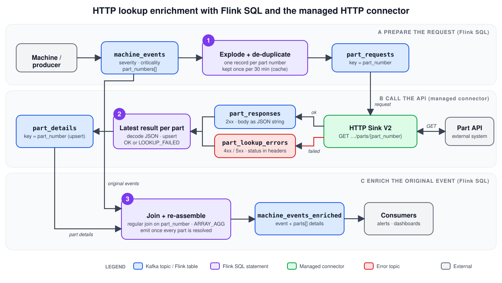

# Enriching machine monitoring events with an external HTTP lookup

**Confluent Cloud for Apache Flink + the fully managed HTTP Sink V2 connector**

This guide explains a pattern for enriching a Kafka stream with data that lives behind an HTTP API, when Flink SQL cannot call that API itself. It comes with a complete working demo that you can deploy, run and test end to end.

---

## 1. The use case

A factory machine publishes monitoring messages to a Kafka topic in Confluent Cloud. Each message has a **severity**, a **criticality** and **one or more part numbers**. The details of each part (description, material, supplier, weight, lifecycle status, cost and so on) are held in an external system that is reachable through an HTTP `GET`:

```
GET https://<part-api-host>/api/v1/parts/<partNumber>
```

Goal: produce an **enriched** event that carries the full part information next to the original message, continuously and with no custom application code.

### Constraint and approach

Flink SQL on Confluent Cloud cannot perform this HTTP call as part of a query. The pattern splits the work into three steps, using Kafka topics as the interface between them:

1. **Flink SQL prepares the request.** It extracts the part numbers from each event, removes duplicates and writes one request record per part number to an *outgoing request topic*.
2. **The managed HTTP Sink V2 connector performs the call.** It consumes the request topic, issues an HTTP `GET` per record and writes the response to a *response topic*. Failures go to an *error topic*.
3. **Flink SQL enriches the original event.** It joins the original events with the responses and writes the enriched events to an output topic.

Everything runs in managed services. There is nothing to operate except the HTTP endpoint itself.

---

## 2. Architecture



The numbered purple boxes are the three Flink SQL statements:

1. **Explode + de-duplicate**: turns each event's `part_numbers` array into one request per part number, sent once per cache window.
2. **Latest result per part**: decodes the connector's responses and errors into one upsert table with the newest result per part number.
3. **Join + re-assemble**: joins the original events with the part details and emits one enriched event once every part has a result.

### Components

| Component | Type | Purpose |
|---|---|---|
| `machine_events` | Kafka topic / Flink table | Incoming monitoring messages (Avro, schema in Schema Registry). |
| `part_requests` | Kafka topic / Flink table | One record per part number to look up. Input of the connector. |
| HTTP Sink V2 connector | Managed connector | Calls the HTTP API with `GET`, writes results and errors to topics. |
| `part_responses` | Kafka topic | Successful responses written by the connector. |
| `part_lookup_errors` | Kafka topic | Failed lookups (404, exhausted retries, ...) written by the connector. |
| `part_lookup_dlq` | Kafka topic | Dead letter queue for unrecoverable connector errors. |
| `part_details` | Kafka topic / Flink table | Latest lookup result per part number (success or failure). |
| `machine_events_enriched` | Kafka topic / Flink table | Output: the original event plus an array of part details. |
| Mock Part API | Small web service | Stand-in for the real API in the demo (see section 3). |

---

## 3. What is in the demo

```
.
├── GUIDE.md                  this document
├── README.md                 short runbook
├── docs/architecture.svg     architecture diagram used in this guide
├── terraform/                API keys and the connector's response/error/DLQ topics, and the connector itself
├── sql/
│   ├── 01-tables.sql         machine_events table
│   ├── 02-part-requests.sql  part_requests table
│   ├── 03-prepare-requests.sql   Flink statement 1: explode + de-duplicate
│   ├── 04-part-details.sql   Flink statement 2: latest result per part
│   ├── 05-enrich.sql         Flink statement 3: join + re-assemble
│   └── flink.py              helper that runs a .sql file on Confluent Cloud via the REST API
├── producer/
│   ├── produce.py            generates fake machine events (Python + Faker)
│   └── peek.py               prints raw records from a topic (key, headers, value)
└── mock-api/                 FastAPI app that mimics the part API (deployable to Fly.io)
```

### Demo data

`producer/produce.py` creates events like this:

```json
{
  "event_id": "5f0c3c2e-0b7a-4a6e-9a39-6a8b8e2d4b11",
  "machine_id": "KQ-036",
  "plant": "Plant North",
  "severity": "WARNING",
  "criticality": "MEDIUM",
  "message": "Bearing vibration elevated",
  "part_numbers": ["PN-223005401-125", "PN-939668623-282-E404"],
  "event_time": "2026-10-23T06:41:12.345Z"
}
```

- `severity` is one of `INFO`, `WARNING`, `ERROR`, `FATAL` (weighted so `INFO` is most common).
- `criticality` is one of `LOW`, `MEDIUM`, `HIGH`, `SAFETY_CRITICAL`, correlated with severity.
- Each event has 1 to 4 distinct part numbers, drawn from a pool of 30 so that **parts repeat** across events and the de-duplication is visible.
- About 15% of events contain an "unknown" part number, which the mock API answers with `404`. This demonstrates failure handling.

### The mock API

The managed connector runs inside Confluent Cloud, so it can only call an endpoint that is reachable from there. The demo includes a tiny mock of the part API (`mock-api/`) that returns deterministic JSON per part number:

```json
{
  "partNumber": "PN-482913057-218",
  "description": "Hydraulic pump 296112",
  "category": "Hydraulic pump",
  "material": "Stainless 1.4301",
  "supplier": { "name": "ZF Friedrichshafen", "supplierId": "SUP79908" },
  "plant": "Plant Coastal",
  "weightKg": 7.39,
  "lifecycleStatus": "PROTOTYPE",
  "producedAt": "2025-02-23T00:00:00+00:00",
  "replacementCostEur": 7752.21,
  "assembly": { "level": 4, "parentPartNumber": "PN-426928233-804", "childCount": 17 }
}
```

> **The response shape is invented.** The real API response will differ. Only the field extraction in `sql/05-enrich.sql` needs to change (section 5.3).

Failure knobs: a part number ending in `-E404` returns `404`, one ending in `-E503` returns `503`. The environment variable `MOCK_LATENCY_MS` sets the simulated latency (default 150 ms).

---

## 4. Prerequisites

- A Confluent Cloud environment with a **Kafka cluster**, **Schema Registry** and a **Flink compute pool** in the same cloud and region (the demo uses Azure).
- A **Cloud API key** (to let Terraform create resource API keys and topics).
- The [Confluent CLI](https://docs.confluent.io/confluent-cli/current/overview.html) (optional, handy for inspection), Terraform ≥ 1.5, Python ≥ 3.10.
- A publicly reachable HTTPS endpoint for the part API: the mock (for example on Fly.io) or, in production, the real API.

Copy `terraform/terraform.tfvars.example` to `terraform/terraform.tfvars` (it is gitignored) and fill in your Cloud API key and secret plus `environment_id`, `kafka_cluster_id`, `compute_pool_id`, `owner_user_id` and `mock_api_base_url`:

```hcl
confluent_cloud_api_key    = "..."
confluent_cloud_api_secret = "..."
```

Also set the `FLINK_CATALOG` and `FLINK_DATABASE` lines in the generated `secrets.env` if your environment and cluster names differ. In Confluent Cloud Flink the **catalog is the environment name** and the **database is the Kafka cluster name**.

---

## 5. How it works, step by step

### 5.1 The input table: `sql/01-tables.sql`

```sql
CREATE TABLE machine_events (
  event_id      STRING,
  machine_id    STRING,
  plant         STRING,
  severity      STRING,
  criticality   STRING,
  message       STRING,
  part_numbers  ARRAY<STRING>,
  event_time    TIMESTAMP_LTZ(3),
  WATERMARK FOR event_time AS event_time - INTERVAL '5' SECOND
) WITH ('value.format' = 'avro-registry');
```

Creating the table creates the Kafka topic and registers the Avro schema. The watermark makes `event_time` an event-time attribute, which the de-duplication in the next step relies on.

### 5.2 Flink statement 1: prepare the requests

`sql/02-part-requests.sql` defines the outgoing topic:

```sql
CREATE TABLE part_requests (
  `key`        STRING,
  part_number  STRING,
  requested_at TIMESTAMP_LTZ(3)
) DISTRIBUTED BY (`key`) INTO 3 BUCKETS
WITH ('changelog.mode' = 'append', 'key.format' = 'raw', 'value.format' = 'avro-registry');
```

- The Kafka record **key** is the plain part number string. Confluent Cloud Flink requires a `raw`-format key column to be named `key`.
- The part number is also in the **value**, because the connector builds the URL from value fields.

`sql/03-prepare-requests.sql` fills it:

```sql
SET 'sql.state-ttl' = '30 min';
SET 'sql.tables.scan.idle-timeout' = '5 s';

INSERT INTO part_requests
SELECT part_number AS `key`, part_number, event_time AS requested_at
FROM (
  SELECT part_number, event_time,
         ROW_NUMBER() OVER (PARTITION BY part_number ORDER BY event_time ASC) AS rn
  FROM (
    SELECT p.part_number, e.event_time
    FROM machine_events e CROSS JOIN UNNEST(e.part_numbers) AS p(part_number)
  )
)
WHERE rn = 1;
```

What it does:

1. `CROSS JOIN UNNEST` turns one event with *n* part numbers into *n* rows.
2. `ROW_NUMBER() ... WHERE rn = 1` keeps only the **first** occurrence of each part number. A part that appears in 1,000 events is requested once, not 1,000 times. This protects the external system and keeps latency low.
3. `sql.state-ttl = 30 min` bounds the de-duplication state. After 30 minutes without activity a part number is forgotten and will be requested again on its next appearance. **This is your lookup cache lifetime.** Tune it to how often the part data changes.
4. `sql.tables.scan.idle-timeout` stops partitions without traffic from holding back the watermark.

### 5.3 The connector

Terraform (`terraform/connector.tf`) creates the connector with these essential settings:

| Setting | Value | Meaning |
|---|---|---|
| `connector.class` | `HttpSinkV2` | Fully managed HTTP Sink V2. |
| `topics` / `api1.topics` | `part_requests` | Request topic. |
| `input.data.format` | `AVRO` | Format of the request records. |
| `http.api.base.url` | `https://<host>` | Base URL of the API. |
| `api1.http.request.method` | `GET` | The lookup method. |
| `api1.http.api.path` | `/api/v1/parts/${part_number}` | Path template. `${part_number}` is replaced with that field of the record value. |
| `api1.max.batch.size` | `1` | One request per record. |
| `api1.max.retries`, `api1.retry.on.status.codes` | `3`, `500-` | Retry server errors (5xx), not 4xx. |
| `api1.http.connect.timeout.ms`, `api1.http.request.timeout.ms` | `10000` | Timeouts. |
| `auth.type` | `NONE` | The mock needs no auth. See section 8 for the real API. |
| `behavior.on.error` | `IGNORE` | A failed call does not stop the connector; it is reported to the error topic. |
| `reporter.result.topic.name` | `part_responses` | Where successful responses go. |
| `reporter.error.topic.name` | `part_lookup_errors` | Where failures go. |
| `errors.deadletterqueue.topic.name` | `part_lookup_dlq` | Unrecoverable errors. |
| `tasks.max` | `2` | Parallelism. |

#### What the connector writes (verified)

**Success topic** `part_responses`:

| Part of record | Content |
|---|---|
| key | The original request key as a JSON string, e.g. `"PN-482913057-218"` (including the quotes). |
| value | The **response body as a JSON-encoded string**, e.g. `"{\"partNumber\":\"PN-4829...\",\"category\":\"Hydraulic pump\", ...}"`. Not Avro, no Schema Registry. |
| headers | `input_record_topic`, `input_record_partition`, `input_record_offset`, `input_record_timestamp` of the request record. |

**Error topic** `part_lookup_errors`:

| Part of record | Content |
|---|---|
| key | Same as above. |
| value | A text description, e.g. `Retry time lapsed, unable to process HTTP request. HTTP Response code: 404, Reason phrase: Not Found, ...` |
| headers | `status_code`, `reason_phrase`, `response_content` (response body), `url`, `error_message`, plus the `input_record_*` headers. |

### 5.4 Flink statement 2: latest result per part

The connector's topics have no schema, so Flink sees them as `key BYTES, val BYTES`. `sql/04-part-details.sql` decodes them and merges successes and failures into one upsert table:

```sql
CREATE TABLE part_details (
  part_number   STRING,
  lookup_status STRING,
  details       STRING,
  looked_up_at  TIMESTAMP_LTZ(3),
  PRIMARY KEY (part_number) NOT ENFORCED
) DISTRIBUTED BY (part_number) INTO 3 BUCKETS
WITH ('changelog.mode' = 'upsert', 'key.format' = 'avro-registry', 'value.format' = 'avro-registry');

INSERT INTO part_details
SELECT JSON_VALUE(CAST(`key` AS STRING), '$')  AS part_number,
       'OK'                                   AS lookup_status,
       JSON_VALUE(CAST(val AS STRING), '$')   AS details,
       $rowtime                               AS looked_up_at
FROM part_responses
UNION ALL
SELECT JSON_VALUE(CAST(`key` AS STRING), '$'),
       'LOOKUP_FAILED',
       JSON_VALUE(CAST(val AS STRING), '$'),
       $rowtime
FROM part_lookup_errors;
```

Key technique: both the key and the value are JSON-encoded *strings*. `JSON_VALUE(x, '$')` returns the string content with the quotes and escaping removed. For the value this yields the original response JSON, which is then queried again with `JSON_VALUE(details, '$.field')`. No UDF is needed.

Because `part_details` is keyed by part number, a newer lookup replaces an older one. Failures are stored too, so an event that contains an unknown part is still completed (with `LOOKUP_FAILED`) instead of waiting forever.

### 5.5 Flink statement 3: enrich the events

`sql/05-enrich.sql` creates the output table and the join:

```sql
INSERT INTO machine_events_enriched
SELECT event_id, machine_id, plant, severity, criticality, message,
       CAST(event_time AS TIMESTAMP_LTZ(3)) AS event_time,
       ARRAY_AGG(ROW(
         part_number, lookup_status,
         JSON_VALUE(details, '$.description'),
         JSON_VALUE(details, '$.category'),
         JSON_VALUE(details, '$.material'),
         JSON_VALUE(details, '$.supplier.name'),
         JSON_VALUE(details, '$.weightKg' RETURNING DOUBLE),
         JSON_VALUE(details, '$.lifecycleStatus'),
         JSON_VALUE(details, '$.replacementCostEur' RETURNING DOUBLE)
       )) AS parts
FROM (
  SELECT x.*, d.lookup_status, d.details
  FROM ( ...events exploded to one row per part, with expected = CARDINALITY(part_numbers)... ) x
  JOIN part_details d ON x.part_number = d.part_number
)
GROUP BY event_id, machine_id, plant, severity, criticality, message, event_time
HAVING COUNT(*) = MAX(expected);
```

(See the file for the complete, runnable statement.)

How it works:

1. Each event is exploded to one row per part number and joined with `part_details` (a regular streaming join, so it does not matter whether the event or the lookup result arrives first).
2. `GROUP BY event_id ... ARRAY_AGG(...)` re-assembles the parts of one event into an array of structured rows.
3. `HAVING COUNT(*) = MAX(expected)` emits the event **only when every part has a result**. An event with 3 parts is emitted once, after the third result is known.

The output record:

```json
{
  "event_id": "...", "machine_id": "KQ-036", "plant": "Plant North",
  "severity": "WARNING", "criticality": "MEDIUM", "message": "Bearing vibration elevated",
  "event_time": "2026-10-23T06:41:12.345Z",
  "parts": [
    { "part_number": "PN-2230...", "lookup_status": "OK", "description": "Valve block 110459",
      "category": "Valve block", "material": "PA66-GF30", "supplier": "Bosch Rexroth",
      "weight_kg": 51.7, "lifecycle_status": "SERIES", "replacement_cost_eur": 2407.34 },
    { "part_number": "PN-9396...-E404", "lookup_status": "LOOKUP_FAILED", "description": null, ... }
  ]
}
```

To adapt the output to the real API response, change the `JSON_VALUE(details, '$.…')` expressions and the `parts` row type in the `CREATE TABLE`.

---

## 6. Deploy

All commands run from the project root. Replace `python` with `.venv/bin/python` if you use the virtual environment.

```bash
# 0. Python environment
python3 -m venv .venv
.venv/bin/pip install requests "confluent-kafka[avro,schemaregistry]" faker

# 1. Infrastructure: API keys, response/error/DLQ topics
cd terraform
terraform init
terraform apply
terraform output -raw secrets_env > ../secrets.env     # credentials used by the scripts below
cd ..

# 2. Flink tables
.venv/bin/python sql/flink.py sql/01-tables.sql
.venv/bin/python sql/flink.py sql/02-part-requests.sql

# 3. The connector (needs the part_requests topic to exist)
cd terraform && terraform apply -var deploy_connector=true && cd ..     # takes ~3 minutes

# 4. Flink statements (each INSERT keeps running)
.venv/bin/python sql/flink.py sql/03-prepare-requests.sql
.venv/bin/python sql/flink.py sql/04-part-details.sql
.venv/bin/python sql/flink.py sql/05-enrich.sql
```

Each statement prints its name and phase, e.g. `[demo-1f913b341443] RUNNING`. You can also see them in the Confluent Cloud UI under **Flink → Statements**.

If you deploy the mock API yourself:

```bash
cd mock-api
fly launch --copy-config --no-deploy --name <your-unique-app-name>   # then edit app name in fly.toml and the terraform variable
fly deploy --ha=false --remote-only
curl https://<your-app>.fly.dev/api/v1/parts/PN-482913057-218
```

---

## 7. Test it

### 7.1 Smoke test the API

```bash
curl -s https://<mock-host>/api/v1/parts/PN-482913057-218 | python -m json.tool
curl -s -o /dev/null -w "%{http_code}\n" https://<mock-host>/api/v1/parts/PN-100000001-001-E404   # expect 404
```

### 7.2 Check the connector

```bash
confluent connect cluster list --environment <env-id> --cluster <cluster-id>
```

Expect status `RUNNING` and 2 running tasks. If it is `FAILED`, run `confluent connect cluster describe <connector-id>` and read the trace.

### 7.3 Produce events

```bash
.venv/bin/python producer/produce.py --count 100 --rate 3
```

Options: `--count` number of events, `--rate` events per second, `--parts-pool` size of the part pool, `--bad-pct` how many unknown parts to mix in. Keep the producer running while you look around (see the watermark note in section 9).

### 7.4 Verify each stage

You can run these queries in the Flink SQL workspace in the Confluent Cloud UI, or save them to a `.sql` file and run `python sql/flink.py file.sql --snapshot` (the `--snapshot` flag runs a bounded point-in-time query).

**Stage 1: events arrive and carry part numbers**

```sql
SELECT event_id, severity, criticality, part_numbers FROM machine_events LIMIT 5;
```

**Stage 2: requests are de-duplicated.** There must be far fewer requests than part-number occurrences, and no repeats within the TTL:

```sql
SELECT
  (SELECT COUNT(*) FROM machine_events) AS events,
  (SELECT COUNT(*) FROM part_requests)  AS requests;

SELECT part_number, COUNT(*) AS times_requested
FROM part_requests GROUP BY part_number HAVING COUNT(*) > 1;   -- expect no rows (within the 30 min TTL)
```

**Stage 3: the connector made the calls.** Look at the raw records:

```bash
set -a; . ./secrets.env; set +a
.venv/bin/python producer/peek.py part_responses 3        # key, headers, JSON-string value
.venv/bin/python producer/peek.py part_lookup_errors 3    # status_code=404 header, error text
```

**Stage 4: responses were decoded**

```sql
SELECT part_number, lookup_status,
       JSON_VALUE(details, '$.category')      AS category,
       JSON_VALUE(details, '$.supplier.name') AS supplier
FROM part_details LIMIT 10;
```

**Stage 5: the enriched output**

```sql
SELECT severity, criticality, message, parts FROM machine_events_enriched LIMIT 5;

-- every event must have been enriched, none lost
SELECT
  (SELECT COUNT(*) FROM machine_events)          AS events,
  (SELECT COUNT(*) FROM machine_events_enriched) AS enriched;
```

During a live run the last few events may be missing until newer events advance the watermark (section 9).

**Expected result from a reference run** (42 events, mix of known and unknown parts): `events = 42`, `enriched = 42`, three unknown part numbers reported as `LOOKUP_FAILED` exactly once each, and every other part shown as `OK`.

### 7.5 Scenario tests

| Scenario | How to trigger | Expected behaviour |
|---|---|---|
| **Cache hit** | Produce 100 events from the default pool of 30 parts. | `part_requests` has at most ~30 + the unknown parts, not 100+ events × parts. The API sees each part once. |
| **Unknown part (404)** | Default `--bad-pct 5`. | A record in `part_lookup_errors` with header `status_code=404`; the event is still enriched with `lookup_status = LOOKUP_FAILED` for that part. |
| **Server error (503)** | Use a part number ending in `-E503` (insert a request manually, see below). | The connector retries 3 times with back-off, then writes to `part_lookup_errors`; the event completes as `LOOKUP_FAILED`. |
| **Slow API** | `fly secrets set MOCK_LATENCY_MS=2000` (or set the env var on your mock host). | Enrichment latency rises by about the API latency; nothing is lost. Raise `tasks.max` to increase concurrency. |
| **API down** | `fly scale count 0` on the mock app. | Requests fail and land in the error topic after retries; Flink keeps running. Restore with `fly scale count 1` and re-send requests for the affected parts (or wait for the TTL). |
| **Cache expiry** | Wait longer than the state TTL (30 min), then produce an event with an already-seen part. | The part is requested again (new record in `part_requests`). |
| **Late response** | Pause the connector (UI or CLI), produce events, resume. | Events wait in the join and are emitted once the responses arrive. |

Inject a manual request (for example for a part that returns `503`) with:

```sql
INSERT INTO part_requests VALUES ('PN-000000001-001-E503', 'PN-000000001-001-E503', CURRENT_TIMESTAMP);
```

### 7.6 Measure end-to-end latency

```sql
SELECT event_id,
       TIMESTAMPDIFF(SECOND, event_time, $rowtime) AS seconds_to_enriched
FROM machine_events_enriched LIMIT 20;
```

With the mock's ~150–250 ms latency expect a few seconds, dominated by the watermark delay (5 s) and connector polling, not by the HTTP call.

---

## 8. Moving to the real API

1. **Endpoint**: set `http.api.base.url` to the real base URL (`https://<your-part-api-host>`) and keep the path template as is.
2. **Authentication**: set `auth.type` and its properties in `terraform/connector.tf`. Supported types are `NONE`, `BASIC` (`connection.user`, `connection.password`), `BEARER` (`bearer.token`), `OAUTH2` client credentials (`oauth2.token.url`, `oauth2.client.id`, `oauth2.client.secret`, ...) and `API_KEY`. Store secrets in `config_sensitive`, not `config_nonsensitive`.
3. **Network**: the managed connector calls the API from Confluent Cloud over the public internet. If the API is private or restricted to allow-listed addresses, work with your Confluent contact on the right option (egress IP allow-listing or private networking) for your cluster type.
4. **Response model**: capture one real response and update the `JSON_VALUE` paths and the `parts` row type in `sql/05-enrich.sql`. For nested arrays in the response, use `JSON_QUERY` to keep a fragment as a JSON string.
5. **Headers**: extra request headers go in `api1.http.request.headers` (`name:value`, separated by `|`).

---

## 9. Behaviour and limits to be aware of

- **Watermark and the last events.** The de-duplication uses event time, so it emits after the watermark advances. With a continuous stream this adds the watermark delay (5 s). When the stream **stops**, the last events remain buffered until newer events arrive. For a demo, keep the producer running.
- **Refresh and duplicates.** When a part is looked up again after the TTL, the new result replaces the old one in `part_details`. Events still held in the join state at that moment can be re-emitted (an update of the same `event_id`, which is an upsert in the output topic). Consumers of `machine_events_enriched` should treat it as an upsert stream keyed by `event_id`.
- **State.** The join in statement 3 keeps events and part details for `sql.state-ttl` (2 h in the demo). Size the TTL to how long a lookup can realistically take plus margin; state grows with the number of events in that window.
- **Throughput.** Each request is a separate HTTP call (`api1.max.batch.size = 1`). Throughput is roughly `tasks.max × (1 / API latency)`. De-duplication reduces calls drastically, but raise `tasks.max` and agree rate limits with the API owner for large workloads.
- **Retries and errors.** Status codes 500 and above are retried (`api1.max.retries`); 4xx responses are not. Results of failed calls are in `part_lookup_errors` with the status code in the `status_code` header. The value of those records is a text, not the response body; the body is in the `response_content` header.
- **Replays.** If you reset or replay the Flink statements, the de-duplication state is rebuilt and the API is called again for every part. Plan for that if the API has quotas.
- **Sensitive data.** The success and error topics contain whatever the API returns. Apply the same access controls as for the source data.
- **Schema-less response topics.** `part_responses` has no schema, so changes in the API response are not caught by Schema Registry; they show up as `NULL` fields after `JSON_VALUE`. Add a data quality check (for example count of `NULL` descriptions) if that matters.
- **Alternative.** Confluent Cloud Flink also offers external tables with REST key search (Open Preview at the time of writing), which performs the lookup inside Flink SQL. The pattern in this guide uses the managed connector instead, which is generally available.

---

## 10. Troubleshooting

| Symptom | Likely cause and fix |
|---|---|
| Terraform: `api1.topics: Topic(s) are not configured for the API` | Add `"api1.topics" = "part_requests"` to the connector config. |
| Flink: `If a key is provided with a 'raw' format it must use 'key' as the column name` | Name the raw key column `` `key` `` (see `part_requests`). |
| `part_requests` stays empty although events arrive | Watermark is not advancing: keep producing, check the `scan.idle-timeout` setting, and check statement 3 is `RUNNING`. |
| Connector `RUNNING` but `part_responses` empty | Look in `part_lookup_errors` and the DLQ. Check the base URL, path template (`${part_number}` must be a field in the request value) and that the API is reachable from the internet. |
| `part_details` has rows but `details` fields are `NULL` | The response JSON differs from the paths in `JSON_VALUE`; inspect a raw record with `peek.py part_responses 1`. |
| Enriched count is lower than event count | Normal for the most recent events on a stopped stream (section 9). Otherwise a part has no result in `part_details`: check the error topic for that part. |
| Flink statement `FAILED` | `confluent flink statement describe <name>` or the UI shows the reason. Fix the SQL and re-run the file. |

---

## 11. Clean up

```bash
# stop the long-running Flink statements (names are printed when they start)
.venv/bin/python sql/flink.py --stop <statement-name> [<statement-name> ...]

# connector, topics and API keys
cd terraform && terraform destroy -var deploy_connector=true && cd ..

# Flink tables (and their topics/schemas): drop in the Flink workspace
#   DROP TABLE machine_events; DROP TABLE part_requests;
#   DROP TABLE part_details;   DROP TABLE machine_events_enriched;

# mock API
fly apps destroy <your-app-name>

# the Cloud API key you gave Terraform, if it was created just for this demo
confluent api-key delete <key-id>
```

The connector and the three Flink statements consume resources (and cost) while they run.
